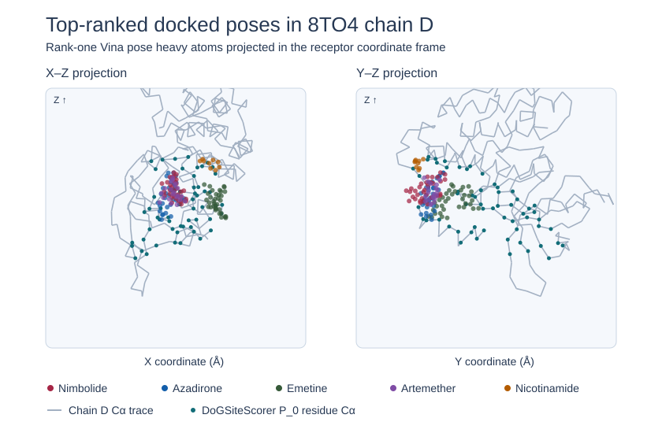

# EGFR 8TO4 Drug Design Capstone

**Rishikesh Muthyala · The Insilico Lab · November 2026**

I used computer-aided drug design (CADD) to study how five small molecules might fit into a pocket in human epidermal growth factor receptor (EGFR). The starting point was the [8TO4 X-ray structure](https://www.rcsb.org/structure/8TO4), a 2.99 Å structure of EGFR(T790M/V948R). I completed the screening, structure preparation, pocket prediction, ADMET profiling, and AlphaFold 3 comparison as part of a three-week virtual training program. I then performed docking and visualized the poses as an independent extension.

## Start here

1. **See the result.** The table and figure below summarize the highest-ranked predicted pose for each compound.
2. **Follow the workflow.** The [methods guide](docs/workflow.md) explains how the compounds, receptor, and predicted pocket were prepared.
3. **Inspect the evidence.** Open the [docking guide](docs/docking.md) for the grid settings and an explanation of how to read the score and distance tables.

A **ligand** is a small molecule tested against the protein. A **pocket** is a cavity where a ligand could fit. **Docking** predicts possible ligand positions and orientations, called **poses**, and assigns each pose a score.

## Workflow at a glance

| Step | Tool | Output |
| --- | --- | --- |
| Screen the five compounds | PubChem, SwissADME, PyMOL | [Compound identifiers and Lipinski checks](data/ligands/compound-summary.csv) |
| Prepare EGFR author chain D | UCSF Chimera Dock Prep | [Prepared receptor structure](structures/8TO4_prepared.pdb) |
| Predict a binding pocket | DoGSiteScorer | [59 residue positions in pocket P_0](data/pocket/p0-residue-list.csv) |
| Predict drug disposition and toxicity | ADMETlab 3.0 | [Ten predicted endpoints per compound](data/admet_predictions.csv) |
| Compare predicted and experimental structures | AlphaFold 3, PyMOL | [Reported alignment of 2,289 atoms with RMSD of 0.965 Å](docs/workflow.md#alphafold-3-comparison) |
| Dock the compounds and visualize the poses | PyRx / AutoDock Vina | [45 scored poses across five compounds](docking/results/all-pose-scores.csv) |

## Independent docking results

| Compound | Best Vina score (kcal/mol) | Closest chain D residue in the top pose |
| --- | ---: | --- |
| Nimbolide | −7.5 | ASN808 (2.81 Å) |
| Azadirone | −7.0 | TYR813 (2.93 Å) |
| Emetine | −6.9 | ARG999 (2.97 Å) |
| Artemether | −6.6 | TYR813 (2.69 Å) |
| Nicotinamide | −5.1 | GLN812 (2.88 Å) |

Nimbolide had the most negative Vina score in this run. Its ADMET profile also showed comparatively high predicted liver toxicity and CYP3A4 inhibition signals. The Vina scores rank poses under this setup. Testing whether the compounds inhibit EGFR would require experimental measurements.

*The figure projects the saved pose coordinates onto two planes. Colored points represent ligand heavy atoms. The gray trace is the EGFR backbone, and teal points mark residues in the predicted pocket.*

## Find the files

| Folder | What it contains |
| --- | --- |
| [data/ligands/](data/ligands/) | The compound summary and PubChem 3D structures, named by compound and PubChem ID |
| [data/pocket/](data/pocket/) | Pocket P_0 atom coordinates and a table of chain D residues |
| [structures/](structures/) | The prepared receptor PDB and the EGFR sequence in FASTA format |
| [docking/inputs/](docking/inputs/) | The receptor PDBQT and saved Vina search box configuration |
| [docking/poses/](docking/poses/) | The nine docked poses per compound, in one PDBQT file per ligand |
| [docking/results/](docking/results/) | The original PyRx export and cleaned score and distance tables |
| [docs/](docs/) | The workflow and docking guides |
| [figures/](figures/) and [scripts/](scripts/) | The pose figure and scripts to regenerate the figure or view the pocket |

### View the predicted pocket in PyMOL

Download [8TO4 in PDB format](https://files.rcsb.org/download/8TO4.pdb) and save it as `8TO4.pdb` in the repository root. From that directory, run `pymol scripts/view_pocket.pml` or enter `@scripts/view_pocket.pml` in PyMOL. The script highlights the predicted pocket residues, including MET790.

To redraw the pose figure with Python 3, run `python scripts/plot_docked_poses.py` from the repository root.

## Credits

This project is based on my training capstone at **The Insilico Lab**. The [methods guide](docs/workflow.md#sources-and-software) lists the data sources and software.
